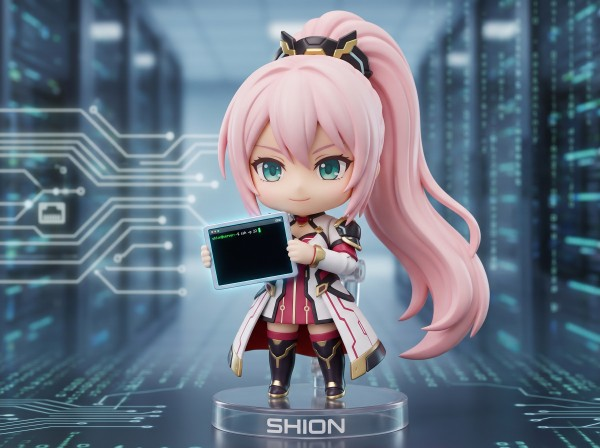

# Shion, an SSH server

Shion is an implementation of a [Secure Shell (SSH)](https://en.wikipedia.org/wiki/Secure_Shell) server, 
intended for clients that are AI agents, all running under one designated unprivileged user on the host
system.

## Primary use case

The client sessions may be sandboxed with wrapper programs like [Bubblewrap](https://github.com/containers/bubblewrap).
The sandboxing parameters are customizable, and can be switched on the user name of the connecting client.
So, AI agents may work on different projects, and have sandboxes provisioned for them per project or 
per role.

With OpenSSH, such an architecture can only be implemented by running multiple `sshd` instances, one
for each sandbox user.  Furthermore, unless those `sshd` instances are fronted by an SSH multiplexer 
like [sshpiper](https://github.com/tg123/sshpiper), they will need to be assigned different network
ports.  

And even if sshpiper is used, managing the port assignments and lifetimes of those internal `sshd` 
instances may be more administratively complex than desired.  For example, if you decide to use
[systemd](https://en.wikipedia.org/wiki/Systemd) to manage them, each `sshd` instance needs
its own `.service` and `.socket` definitions, just to implement socket activation for sshpiper,
yet not have idle `sshd` instances linger forever — as sshpiper does not natively support 
launching SSH servers on demand.

Shion, on the other hand, is more lightweight: you can configure what command line is used to
launch a sandboxed session process, whenever it is neeeded.

## Why a new implementation

Writing a new SSH implementation might seem over-kill, but in the age of AI coding agents it is
not so hard, and the author is getting AI to teach him coding in Rust through this project. (The 
author has much more experience coding in C++ and C#, including with asynchronous architectures.)

The C code of OpenSSH is not easy to understand, much less modify.  And in this day and age, 
some might object to running a privileged network service written in an “unsafe” programming 
language.  Rust and its SSH2 protocol library “[russh](https://github.com/Eugeny/russh)” is definitely 
a step in a good direction, but do note that russh natively does *not* implement privilege separation.
Shion does, using “russh” as an indispensable building block.

## Status

Shion is a work in progress.  However, as of October 15, 2026, you can connect to Shion's SSH server process, 
and use it, through a standard SSH client like OpenSSH.

In the future, we may implement the so-called “[SSH3](https://github.com/francoismichel/ssh3)” protocol
as an alternative to SSH2.  In fact, Shion's initial design has very much been inspired by 
replacing SSH2's custom connection and transport layers with HTTP/3 + QUIC, in an attempt to
simplify implementation.

## About the name

*[Shion](https://en.wikipedia.org/wiki/Shion)* is a Japanese name, often female. This name is not used by 
any other software project as far as the author knows, and the beginning consonant sounds like “ssh”.

(Though those linguistically-inclined may note that in native Japanese, “sh” is actually pronounced as a 
[voiceless alveolo-palatal fricative](https://en.wikipedia.org/wiki/Voiceless_alveolo-palatal_fricative), /ɕ/.)

*Shion* can be written natively in various ways, including 紫苑, 詩音, 汐音, 志恩, シオン. The author
has not decided yet! 😄
